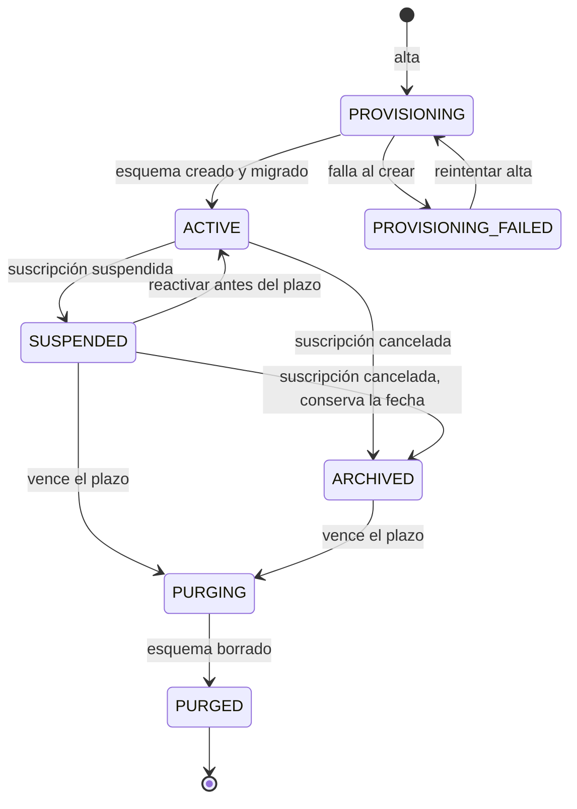

# Arquitectura de Playtodoo Kuador

> Los ejemplos de este documento son ilustrativos. Usan nombres ficticios (por ejemplo, «Canchas El Sol») para aclarar cómo funciona cada idea. No son datos del negocio ni decisiones tomadas. Lo que sigue en [POR DEFINIR] sigue pendiente.

## Stack

_Lo escribe el tablero a partir de las piezas del proyecto (Configuración → Piezas y repositorio): no lo edites a mano._

| Pieza | Tipo | Stack | Dónde | Compilar | Probar | Levantar |
|---|---|---|---|---|---|---|
| api | Backend | Java 25 · Spring Boot 4 | `api/` | `./mvnw -B package` | `./mvnw -B verify` | `./mvnw spring-boot:run` |
| backoffice | Frontend | Angular · TypeScript | `backoffice/` | `npm run build` | `npm test -- --watch=false` | `npm start` |
| app | Frontend | React · Vite · TypeScript | `app/` | `pnpm build` | `pnpm test` | `pnpm dev` |
| movil | Móvil | Flutter | `movil/` | — | — | — |

## Piezas y quién las usa

Nota de nombres: en la idea original «Backoffice» designaba la web de los complejos y «Backoffice global» la de Kuador. En las piezas del tablero, `backoffice` es el de Kuador. Este documento sigue las piezas.

| Pieza | Usuarios | Función |
|---|---|---|
| `api` | Todas las apps | Backend centralizado con la lógica de negocio y el aislamiento por tenant |
| `backoffice` | Equipo Kuador | Backoffice global (Angular): complejos, tenants, planes, suscripciones, pagos de suscripción, usuarios globales, parámetros y métricas |
| `app` | Propietarios, administradores y personal del complejo | Web del complejo (React): configuración, canchas, horarios, reservas, calendario, novedades, torneos, usuarios y permisos, plan y suscripción |
| `movil` | Jugadores | Registro, búsqueda de complejos cercanos, horarios, reservas, historial, novedades y torneos |

Ejemplo de uso de cada pieza:

- Una persona del equipo de Kuador entra a `backoffice` y suspende al complejo ficticio «Canchas El Sol» por falta de pago de la suscripción.
- La administradora de «Canchas El Sol» entra a `app` en `canchaselsol.playtodoo.com` y bloquea la cancha 2 el sábado por mantenimiento.
- Una jugadora abre `movil`, busca complejos cercanos y reserva la cancha 1 para el viernes a las 20:00.

La persona que dio el brief llamó «la app» al cliente del jugador. Se asume que ese cliente es `movil` (Flutter) y que `app` (React) es la web del complejo. [POR DEFINIR: confirmar esta asignación].

## Arquitectura del backend

La `api` es un **monolito modular**: una sola aplicación desplegable, dividida en módulos con responsabilidades y fronteras claras (ver Módulos). Cada módulo sigue una **arquitectura hexagonal** (puertos y adaptadores). La comunicación entre módulos se hace con **Spring Events**.

- **Monolito modular:** un único despliegue. Cada módulo es dueño de su lógica y de sus datos, y no accede directamente a las clases internas ni a las tablas de otro módulo.
- **Arquitectura hexagonal por módulo:**
  - **Dominio:** reglas de negocio, sin dependencias de framework ni de infraestructura.
  - **Aplicación:** casos de uso y puertos de entrada y de salida.
  - **Adaptadores de entrada:** API REST, consumida por las tres apps.
  - **Adaptadores de salida:** persistencia en PostgreSQL e integraciones externas, siempre detrás de una interfaz (puerto).
- **Spring Events:** un módulo publica eventos de dominio y otros módulos reaccionan sin acoplarse entre sí. El catálogo de eventos está en «Catálogo de eventos». [POR DEFINIR: qué eventos de otros módulos se procesan de forma asíncrona].
- **Multi-tenant:** la resolución del tenant y el esquema activo se manejan de forma transversal en el módulo Tenancy, no dentro de cada caso de uso.
- **Verificación de fronteras entre módulos:** [POR DEFINIR: herramienta para hacerlas cumplir (por ejemplo, Spring Modulith o pruebas de arquitectura)].

### Ejemplo: capas hexagonales del módulo Reservas (ilustrativo)

Los nombres son ilustrativos y no fijan la estructura final de paquetes.

```
reservas/
  dominio/
    Reserva                  (entidad: cancha, fecha, horario, estado)
    PoliticaCancelacion      (regla: ¿se puede cancelar a estas horas?)
  aplicacion/
    entrada/
      CrearReserva           (puerto de entrada, caso de uso)
      CancelarReserva        (puerto de entrada, caso de uso)
    salida/
      ReservaRepositorio     (puerto de salida, interfaz)
  infraestructura/
    entrada/
      ReservaController      (adaptador REST)
    salida/
      ReservaRepositorioPostgres   (adaptador de persistencia)
```

El dominio no conoce Spring ni PostgreSQL. El controlador llama al puerto de entrada y el caso de uso usa el puerto de salida. Cambiar la persistencia no toca las reglas de negocio.

### Ejemplo: comunicación entre módulos con Spring Events (ilustrativo)

Una jugadora cancela una reserva:

1. El módulo **Reservas** cancela la reserva y publica el evento `BookingCancelled` después del commit.
2. Un módulo interesado (por ejemplo, unas futuras notificaciones) escucha el evento y reacciona.
3. Reservas no llama directamente a ese módulo ni conoce sus clases internas.

La ocupación de las canchas **no** se copia a Disponibilidad por eventos: el calendario la lee de Reservas (decisión D4 en «Catálogo de eventos» y ADR-006).

### Catálogo de eventos

Eventos de dominio publicados con Spring Events. El publicador los emite dentro de la transacción y los consumidores escuchan con `@TransactionalEventListener(phase = AFTER_COMMIT)`, así nunca reaccionan a un cambio que se revirtió. Ningún evento lleva datos personales (nombre o teléfono del titular).

| Evento | Módulo que lo publica | Cuándo | Carga |
|---|---|---|---|
| `BookingCreated` | Reservas | Se crea una reserva (pendiente del jugador o confirmada del personal) | `tenantId`, `bookingId`, `courtId`, `start`, `end`, `kind` |
| `BookingConfirmed` | Reservas | El jugador confirma su pendiente dentro del plazo | Igual que arriba |
| `BookingCancelled` | Reservas | El jugador cancela su pendiente o el personal cancela una reserva o quita un bloqueo | Igual que arriba |
| `BookingExpired` | Reservas | Un pendiente vence (tarea programada) | Igual que arriba |
| `SlotBlocked` | Reservas | El personal bloquea una franja libre | Igual que arriba |
| `TenantActivated` | Tenancy | El complejo queda `ACTIVE`: al terminar la provisión, al activarlo tras una suspensión o al reactivarlo desde el archivado | `tenantId`, `subdomain`, `occurredAt` |
| `TenantSuspended` | Tenancy | Kuador suspende un complejo activo | `tenantId`, `occurredAt` |
| `TenantArchived` | Tenancy | Baja: el complejo pasa a `ARCHIVED` con su plazo de retención | `tenantId`, `purgeDueAt`, `occurredAt` |
| `TenantSubdomainChanged` | Tenancy | El propietario cambia el subdominio; el anterior queda retirado | `tenantId`, `previousSubdomain`, `subdomain`, `occurredAt` |
| `TenantPurged` | Tenancy | Baja definitiva: el esquema del complejo se eliminó | `tenantId`, `purgedAt` |
| `TenantStatusChanged` | Tenancy | Cambia el estado del tenant (PLATODO-27) | `tenantId`, `status`, `purgeDueAt` |
| `SubscriptionStatusChanged` | Planes y suscripciones | Kuador cambia a mano el estado de la suscripción | `tenantId`, `from`, `to`, `changedBy`, `occurredAt` |
| `SubscriptionPlanChanged` | Planes y suscripciones | Kuador cambia el plan de un complejo | `tenantId`, `planId`, `changedBy`, `occurredAt` |
| `OperatorCapabilitiesChanged` | Identidad y acceso | El `SUPER_ADMIN` habilita o deshabilita capacidades del `OPERATOR` | `capabilities`, `changedBy`, `occurredAt` |
| `SupportSessionOpened`, `SupportSessionClosed` | Acceso de soporte | Se abre o cierra una sesión de soporte | `sessionId`, `tenantId`, `platformUserId`, `occurredAt` |

En la épica PLATODO-25 no hay consumidores obligatorios; notificaciones y métricas los usarán en otras tarjetas. Contrato REST de Reservas: `contracts/bookings.openapi.yaml`.

Eventos `Tenant*` (épica PLATODO-26, ADR-013): llevan el `tenantId` para que un consumidor que toque datos del complejo abra su propio ámbito de tenant (ADR-010); el ámbito no se hereda entre hilos. **Excepción a `AFTER_COMMIT`:** `TenantPurged` se escucha de forma **síncrona dentro de la transacción de purga**. Sus consumidores obligatorios son Auditoría (anonimiza los motivos de acceso) y Planes y suscripciones (quita los datos personales y conserva suscripción y pagos); si uno falla, el complejo no queda `PURGED`. Contrato REST de Tenancy: `contracts/tenancy.openapi.yaml`.

Eventos de la épica PLATODO-27 (ADR-014 a ADR-020). **Excepciones síncronas, en la misma transacción:** `SubscriptionStatusChanged` (Tenancy aplica el efecto en el tenant: bloqueo, plazo de conservación) y `TenantStatusChanged` (Complejos y canchas oculta o muestra el complejo en el catálogo; Acceso de soporte invalida las sesiones al pasar a `PURGING`). Así el estado comercial, el acceso y el catálogo nunca quedan desalineados; si un consumidor falla, se revierte todo. `SubscriptionPlanChanged`, `OperatorCapabilitiesChanged` y `SupportSession*` se escuchan `AFTER_COMMIT` y hoy solo los usa el registro propio. Contrato REST del backoffice: `contracts/platform-backoffice.openapi.yaml`.

**D4 · Ocupación sin copia en Disponibilidad:** la fuente única de verdad de la ocupación es la tabla `booking` de Reservas. El calendario (jugador y personal) lee la ocupación del puerto de entrada de Reservas (`GET /courts/{courtId}/occupancy`, `GET /staff/bookings`). Disponibilidad no mantiene una copia actualizada por eventos. Se descartó la copia porque la consistencia eventual mostraría como libres franjas ya tomadas. Disponibilidad sigue siendo dueña de la configuración de la cancha (duración y franjas válidas), que Reservas consume por el puerto `CourtSlotRules`.

## Ciclo de vida del tenant y suscripción

El estado comercial de la suscripción y el ciclo de vida del tenant son modelos distintos (ADR-014). Kuador solo cambia la suscripción, siempre a mano; Tenancy aplica el efecto. Detalle de transiciones en `contracts/platform-backoffice.openapi.yaml`.



| Estado del tenant | Personal y jugadores | Soporte de Kuador (con sesión y motivo, ADR-020) | Catálogo |
|---|---|---|---|
| `PROVISIONING`, `PROVISIONING_FAILED` | No disponible | No | Oculto |
| `ACTIVE` | Como siempre | `SUPER_ADMIN` u `OPERATOR` con `TENANT_DATA_ACCESS`; lectura y edición | Visible |
| `SUSPENDED` (suscripción suspendida) | `403 TENANT_UNAVAILABLE` | Solo `SUPER_ADMIN`; lectura y edición, lo creado queda inactivo (ADR-019) | Oculto |
| `ARCHIVED` (suscripción cancelada, terminal) | `403 TENANT_UNAVAILABLE` | Solo `SUPER_ADMIN`; igual que suspendido | Oculto |
| `PURGING`, `PURGED` | `404 TENANT_NOT_FOUND` | No; sesiones invalidadas | Borrado |

- **Plazo de conservación:** 45 días por defecto (`retention.default-days`), desde la suspensión o la cancelación; ajustable por complejo por el `SUPER_ADMIN`. Al vencer, la purga borra el esquema de forma automática (ADR-015).
- **Qué queda tras la purga:** lápida del tenant, suscripción, pagos, historial y auditoría (estos dos, 365 días); se borran el esquema y la fila del catálogo y se redactan los datos personales del global (ADR-016).
- **Reservas inactivas:** derivadas del estado del tenant, sin escribir en `booking` (ADR-019).

## Arquitectura del frontend

Son tres clientes independientes que consumen la misma `api`. Ninguno accede a la base de datos. El tenant se identifica por subdominio en la web del complejo (ver ADR-002).

| Pieza | Tecnología | Arquitectura | Notas |
|---|---|---|---|
| `movil` | Flutter | [POR DEFINIR: organización de capas y gestión de estado] | Jugadores. Sin pagos dentro de la app |
| `app` | React | [POR DEFINIR: organización de carpetas, gestión de estado y acceso a datos] | Web del complejo. Solo ve datos de su propio tenant |
| `backoffice` | Angular | [POR DEFINIR: organización de carpetas, gestión de estado y acceso a datos] | Equipo Kuador. Acceso a datos de complejos con permiso y auditoría |

Criterios comunes propuestos para los tres, a confirmar:

- Organización por funcionalidad, alineada con los módulos del backend.
- Acceso a la `api` aislado en una capa propia, separada de la interfaz.
- Autenticación y roles gestionados de forma centralizada en cada cliente.
- [POR DEFINIR: sistema de diseño compartido entre `app` (React) y `backoffice` (Angular). Al ser frameworks distintos no se pueden compartir componentes; solo se podrían compartir criterios visuales (colores, tipografías, espaciados). ¿Se hace así o cada web tiene su propia librería?].

Ejemplo de los criterios comunes aplicados a la funcionalidad «reservas» en `app` (ilustrativo, no fija la organización final):

```
reservas/
  api/        (llamadas a la api de Reservas, sin lógica de pantalla)
  pantallas/  (lista de reservas, calendario de ocupación)
  componentes/
```

La carpeta se llama igual que el módulo `Reservas` del backend. Si cambia la forma de llamar a la `api`, solo se toca la subcarpeta `api/`.

## Datos

- **Base de datos:** PostgreSQL con estrategia Schema per Tenant: cada complejo tiene su propio esquema.
- **Esquema global** (propuesta): tenants, planes, suscripciones, pagos de suscripción, usuarios globales, parámetros de plataforma, auditoría y catálogo de complejos (ver abajo). Tablas de la épica PLATODO-26 y su módulo dueño: `tenant` y `tenant_domain` (Tenancy), `player_account` y `platform_user` (Identidad y acceso), `access_session` y `access_audit_event` (Auditoría), `notification_outbox` (Notificaciones). Tablas de la épica PLATODO-27: `plan`, `plan_field_definition`, `subscription`, `subscription_history` y `subscription_payment` (Planes y suscripciones); `platform_capability`, `operator_capability` y `capability_change` (Identidad y acceso); `platform_parameter` (parámetros de plataforma: plazo de conservación, retenciones, duración de sesión, monedas y periodicidades). `tenant` suma `PROVISIONING_FAILED`, `retention_days` y `purge_due_at` también al suspender, `owner_email` y `version`; `access_session` y `access_audit_event` se amplían para la sesión de soporte (ADR-020).
- **Esquema de cada complejo:** `t_<uuid sin guiones>`, inmutable y separado del subdominio (ADR-010). Contiene `staff_user` (el personal vive en su complejo) y las tablas operativas (reservas, canchas, etc.).
- **Esquema `no_tenant`:** vacío. Es el `search_path` de toda conexión devuelta al pool, para que una conexión reutilizada sin tenant no vea datos de ningún complejo (ADR-010).
- **Selección del esquema:** dos unidades de persistencia, global y de tenant. La de tenant usa el `TenantScope` (`ScopedValue`) y falla si no hay tenant activo; nunca usa un esquema por defecto (ADR-010).
- **Herramienta de migraciones:** Flyway (ADR-009). Migraciones globales en `api/src/main/resources/db/migration/global`, aplicadas al arrancar. Migraciones de tenant en `api/src/main/resources/db/migration/tenant`; `TenantSchemaMigrator` (Tenancy) las aplica a un esquema con su propio `flyway_schema_history`, al provisionar un complejo y, al arrancar, a cada tenant `ACTIVE`, `SUSPENDED` o `ARCHIVED`, de a uno.
- **Reservas sin solapes:** la tabla `booking` de cada esquema de tenant tiene una restricción de exclusión (`btree_gist`) que impide dos reservas o bloqueos activos solapados en la misma cancha (ADR-006).

Ejemplo de cómo se ve la base con dos complejos ficticios (los nombres de esquema son ilustrativos):

| Esquema | Contiene |
|---|---|
| `global` | tenants, planes, suscripciones, pagos de suscripción, usuarios globales, parámetros, auditoría, catálogo de complejos |
| esquema de «Canchas El Sol» | canchas, horarios, reservas, novedades, torneos y usuarios de ese complejo |
| esquema de «Complejo La Esquina» | canchas, horarios, reservas, novedades, torneos y usuarios de ese complejo |

Una solicitud a `canchaselsol.playtodoo.com` solo puede leer y escribir en el esquema de «Canchas El Sol». Las reservas de «Complejo La Esquina» no son visibles desde ahí.

### Búsqueda de complejos cercanos entre tenants (propuesta, a confirmar)

Problema: con Schema per Tenant, la ubicación de cada complejo vive en su propio esquema. Consultar «los complejos cerca del jugador» obligaría a recorrer todos los esquemas, lo que es lento y rompe el aislamiento.

Propuesta: un **catálogo global de complejos** en el esquema global, con solo datos públicos, y separar la consulta en dos pasos.

1. **Búsqueda de cercanos (esquema global).** La consulta de ubicación se resuelve únicamente contra el catálogo global. Un jugador envía su ubicación y recibe los complejos cercanos ordenados por distancia. No se toca ningún esquema de tenant.
   - Contenido del catálogo (propuesta): identificador del tenant, subdominio, nombre, dirección, latitud y longitud, contacto, estado del tenant (solo se listan los activos). [POR DEFINIR: deportes o tipos de cancha, para poder filtrar].
   - Cálculo de distancia: [POR DEFINIR: extensión PostGIS con índice espacial, o cálculo de distancia con latitud y longitud e índice por rango].
2. **Detalle, canchas y horarios (esquema del tenant).** Al elegir un complejo, la `api` resuelve su tenant, activa su esquema y consulta allí canchas, disponibilidad y reservas. Estas consultas nunca cruzan tenants.

Ejemplo de filas del catálogo global (datos ficticios):

| Tenant | Subdominio | Nombre | Dirección | Lat / Lon | Estado |
|---|---|---|---|---|---|
| t-001 | canchaselsol | Canchas El Sol | Calle Ejemplo 123 | 0.0000 / 0.0000 | activo |
| t-002 | laesquina | Complejo La Esquina | Av. Ficticia 456 | 0.0000 / 0.0000 | suspendido |

Ejemplo de recorrido completo:

1. La jugadora abre `movil` y envía su ubicación.
2. La `api` consulta solo el catálogo global y devuelve «Canchas El Sol», ordenado por distancia. «Complejo La Esquina» no aparece porque está suspendido.
3. La jugadora elige «Canchas El Sol». La `api` resuelve el tenant `t-001`, activa su esquema y devuelve canchas y horarios libres.

Sincronización del catálogo:

- La fuente de verdad de la información del complejo sigue siendo su esquema. El módulo Complejos y canchas publica un evento (Spring Events) cuando cambian datos públicos o ubicación, y el catálogo global se actualiza a partir de él.
- La activación o suspensión del tenant (módulo Tenancy) actualiza el estado en el catálogo, de modo que un complejo suspendido deja de aparecer.
- [POR DEFINIR: cómo se obtienen la latitud y longitud (el complejo marca el punto en un mapa o se calculan a partir de la dirección)].
- [POR DEFINIR: si el MVP permite filtrar los cercanos por disponibilidad en una fecha y hora. Eso requeriría consultar cada tenant o mantener una copia agregada de disponibilidad; la propuesta actual lo deja fuera y muestra la disponibilidad solo al entrar al complejo].

Ejemplo de sincronización: la administradora de «Canchas El Sol» corrige el teléfono de contacto en `app`. El módulo Complejos y canchas guarda el cambio en el esquema del complejo y publica el evento de cambio de datos públicos. El catálogo global actualiza la fila `t-001`.

## Módulos

Propuesta inicial del backend `api`, a confirmar al diseñar. Cada módulo expone su API pública mediante sus puertos de entrada y los eventos que publica.

| Módulo | Responsabilidad | API pública |
|---|---|---|
| Tenancy | Resolver el complejo por subdominio, `TenantScope`, filtro de acceso por estado y validación de la sesión de soporte, ciclo de vida (alta con reintento, efecto de la suscripción, plazo de conservación y purga automática) y subdominios | `contracts/tenancy.openapi.yaml`; `TenantScope`, `TenantDirectory` (consulta por lote); eventos `Tenant*`; escucha `SubscriptionStatusChanged` |
| Identidad y acceso | Registro e inicio de sesión de jugadores, usuarios del complejo y usuarios globales; roles `SUPER_ADMIN` y `OPERATOR` con capacidades habilitables (ADR-017) | Login en `contracts/tenancy.openapi.yaml`; `GET /me` y capacidades en `contracts/platform-backoffice.openapi.yaml`; `AuthenticatedPrincipal`, `CapabilityGuard` |
| Complejos y canchas | Información comercial, ubicación, contacto y canchas; publicar los datos públicos al catálogo global de complejos y atender la búsqueda de cercanos | [POR DEFINIR] |
| Disponibilidad | Horarios, duración y franjas válidas por cancha (no guarda la ocupación, ver D4) | Configuración de la cancha consumida por Reservas mediante el puerto `CourtSlotRules`; resto [POR DEFINIR] |
| Reservas | Crear, consultar y cancelar reservas y bloqueos, pendiente de 5 minutos y ocupación de cada cancha, sin duplicados ni conflictos | `contracts/bookings.openapi.yaml`; eventos del «Catálogo de eventos» |
| Novedades | Publicación y consulta de novedades | [POR DEFINIR] |
| Torneos | Publicación y administración de torneos | [POR DEFINIR] |
| Planes y suscripciones | Planes con campos básicos y adicionales (ADR-018), suscripción con instantánea del plan, transiciones manuales, pagos registrados a mano, historial de 365 días y modelo de lectura del listado y detalle de complejos | `contracts/platform-backoffice.openapi.yaml`; eventos `Subscription*`; listener síncrono de `TenantPurged` |
| Acceso de soporte y Auditoría | Sesiones de soporte con motivo ligadas a una persona y a un complejo (ADR-020) y registro síncrono de cada solicitud bajo sesión, permitida o denegada, con retención de 365 días | `contracts/platform-backoffice.openapi.yaml` («Support access»); `RecordAccess` (síncrono); listener síncrono de `TenantPurged` (redacta motivos) |
| Métricas | Indicadores globales para Kuador | [POR DEFINIR] |

Ejemplo de qué módulos participan al crear una reserva (ilustrativo):

1. `movil` envía la solicitud a la `api` con el subdominio del complejo.
2. **Tenancy** resuelve el tenant y activa su esquema.
3. **Identidad y acceso** comprueba que la jugadora está autenticada.
4. **Reservas** obtiene la duración de la cancha de Disponibilidad (`CourtSlotRules`) y crea la reserva pendiente. Si el horario ya está ocupado, la base rechaza la fila y la `api` responde `409 SLOT_UNAVAILABLE` (ver ADR-006).
5. **Reservas** publica `BookingCreated` después del commit. El calendario ya ve la franja ocupada porque lee la ocupación de Reservas (D4).

## Integraciones

No hay integraciones externas definidas para el MVP. El cobro de suscripciones es manual (transferencia o factura) y el jugador no paga en la app.

[POR DEFINIR: mapas y geolocalización, notificaciones y correo]. Cada integración se aísla detrás de una interfaz propia del módulo que la usa (puerto de salida en la arquitectura hexagonal).

Ejemplo: si se decide enviar correos de confirmación de reserva, el módulo Reservas depende de un puerto de salida `NotificadorDeReservas`. Un adaptador implementa ese puerto con el proveedor elegido. Cambiar de proveedor solo cambia el adaptador. El proveedor concreto sigue [POR DEFINIR].

## Decisiones (ADR)

- **ADR-001 · Schema per Tenant en PostgreSQL** ({date}): cada complejo es un tenant con su propio esquema, para garantizar que gestione solo sus datos.
- **ADR-002 · Tenant identificado por subdominio** ({date}): el complejo se resuelve por subdominio (complejo.playtodoo.com), tanto en la web del complejo como cuando el jugador consulta sus canchas. Ejemplo: `canchaselsol.playtodoo.com` resuelve al tenant «Canchas El Sol». Hosts (actualizado en PLATODO-26):

  | Host | Contexto | Quién lo usa |
  |---|---|---|
  | `{subdominio}.playtodoo.com` | Web `app`; `/api/**` va a la `api` en **contexto de tenant** | `app`, `movil` (datos del complejo), `backoffice` (con sesión de soporte y `X-Support-Session`, ADR-020) |
  | `api.playtodoo.com` | `api` en **contexto global** (sin tenant) | `movil` (cuenta de jugador), `backoffice` (plataforma) |
  | `admin.playtodoo.com` | Web `backoffice` | Equipo Kuador |
  | `playtodoo.com`, `www` | Sitio raíz; destino de «Ir a Playtodoo» en `app` (en `movil` vuelve al inicio de la propia app) | Público |

  El dominio raíz es configurable por entorno (`playtodoo.root-domain`); en local, `{subdominio}.localhost`. Un endpoint de tenant pedido en el host global, o uno global pedido en un host de tenant, responde `404`. El host solo se toma de `X-Forwarded-Host` cuando viene de un proxy de confianza. Reglas del subdominio en ADR-012.
- **ADR-003 · Acceso de Kuador con motivo y auditoría** ({date}): el equipo de Kuador puede leer y editar datos operativos de un complejo solo con permiso y con un motivo registrado en la auditoría. Ejemplo: una persona de soporte de Kuador necesita ver las reservas de «Canchas El Sol» por un reclamo. Antes de acceder registra el motivo («reclamo por reserva duplicada») y queda en la auditoría con quién, cuándo y a qué accedió. Mecanismo (sesión de acceso solo para el dueño de Kuador y auditoría síncrona): ADR-011.
- **ADR-004 · Sin pagos en la plataforma en el MVP** ({date}): el jugador paga la reserva en el complejo y el complejo paga su suscripción a Kuador por transferencia o factura. La plataforma solo registra el seguimiento. Ejemplo: la jugadora reserva en `movil` y paga en la recepción del complejo; el complejo transfiere su suscripción mensual a Kuador y el equipo de Kuador registra ese pago en `backoffice`.
- **ADR-005 · Tres aplicaciones en paralelo sobre un backend único** ({date}): móvil, web del complejo y backoffice global se construyen a la vez contra la misma `api`.
- **ADR-006 · Prevención de reservas duplicadas** (2026-11-25, propuesto): el sistema nunca permite dos reservas o bloqueos activos (pendiente vigente o confirmada) solapados en la misma cancha. Mecanismo: tabla única `booking` por esquema de tenant con el horario como `tstzrange [inicio, fin)` y una restricción de exclusión de PostgreSQL (`EXCLUDE USING gist (court_id WITH =, period WITH &&) WHERE status IN ('PENDING','CONFIRMED')`, extensión `btree_gist`). La violación (SQLSTATE `23P01`) se traduce a `409` con Problem Details y `code` estable. El pendiente de 5 minutos vence de forma perezosa al reservar, con una tarea programada por tenant y como estado efectivo en las lecturas; confirmar es un `UPDATE` condicional. Ejemplo: dos jugadores piden a la vez la cancha 1 del viernes a las 20:00; solo una reserva se crea y la otra recibe `SLOT_UNAVAILABLE`. Detalle y alternativas: `docs/adr/ADR-006-prevencion-de-reservas-duplicadas.md`.
- **ADR-007 · Monolito modular con arquitectura hexagonal y Spring Events** ({date}): el backend `api` es un monolito modular. Cada módulo sigue arquitectura hexagonal y los módulos se comunican entre sí mediante Spring Events, sin acceder a las partes internas de otros módulos.
- **ADR-008 · Catálogo global de complejos para la búsqueda de cercanos** ({date}): propuesta a confirmar. La búsqueda por ubicación se resuelve en el esquema global con datos públicos de los complejos, sincronizados mediante eventos desde cada tenant. Los datos operativos (canchas, horarios, reservas) se consultan solo en el esquema del tenant elegido, sin consultas entre esquemas.
- **ADR-009 · Migraciones con Flyway** (2026-11-25, propuesto): migraciones SQL versionadas con Flyway, un conjunto para el esquema global y otro aplicado a cada esquema de tenant (al crearlo y en cada despliegue), con historial propio por esquema. Detalle y alternativas: `docs/adr/ADR-009-migraciones-con-flyway.md`.
- **ADR-010 · Persistencia multi-tenant por esquema con falla cerrada** (2026-11-25, propuesto): dos unidades de persistencia (global y de tenant), ámbito de tenant con `ScopedValue` que falla si no hay tenant, `search_path` por conexión desde un pool único con reinicio a `no_tenant` al liberarla, y esquemas `t_<uuid>` separados del subdominio. Ejemplo: un job que olvida abrir el ámbito de «Canchas El Sol» falla en vez de leer otro complejo. Detalle: `docs/adr/ADR-010-persistencia-multi-tenant.md`.
- **ADR-011 · Sesiones de acceso de Kuador y auditoría síncrona** (2026-11-25, propuesto; ajustado por ADR-017 y ADR-020): solo el dueño de Kuador abre una sesión con motivo, limitada a un complejo y a 30 minutos; accede por el host del complejo con `X-Platform-Access-Session` y cada solicitud se audita antes de ejecutarse (si la auditoría falla, se deniega). Detalle: `docs/adr/ADR-011-sesiones-de-acceso-de-kuador-y-auditoria.md`.
- **ADR-012 · Reglas de subdominio** (2026-11-25, propuesto): formato, reservados, sugerencia desde el nombre, cambio por el propietario y subdominios anteriores retirados para siempre. Detalle: `docs/adr/ADR-012-reglas-de-subdominio.md`.
- **ADR-013 · Ciclo de vida del complejo y baja definitiva** (2026-11-25, propuesto; ajustado por ADR-014 a ADR-016): suspensión, archivado de 45 días modificable, reactivación y purga diaria que elimina el esquema y conserva sin datos personales el tenant, la auditoría, la suscripción y sus pagos. Detalle: `docs/adr/ADR-013-ciclo-de-vida-y-baja-definitiva.md`.
- **ADR-014 · Estado de la suscripción y ciclo de vida del tenant separados** (2026-11-26, propuesto): Kuador cambia a mano la suscripción y Tenancy aplica el efecto por un evento síncrono; Suspendida lleva a `SUSPENDED`, Cancelada a `ARCHIVED` (terminal) y ambas bloquean e inician el plazo. Ejemplo: al suspender «Canchas El Sol» su web responde «no disponible» en el mismo commit. Detalle: `docs/adr/ADR-014-suscripcion-y-ciclo-de-vida-del-tenant.md`.
- **ADR-015 · Purga automática al vencer el plazo** (2026-11-26, propuesto): al vencer el plazo desde la suspensión o la cancelación, una tarea diaria borra el esquema sin confirmación; antes se avisa y se puede ampliar. Detalle: `docs/adr/ADR-015-purga-automatica-al-vencer-el-plazo.md`.
- **ADR-016 · Alcance de «borrar todo»** (2026-11-26, propuesto): se borran el esquema y la fila del catálogo y se redactan los datos personales del global; quedan suscripción, pagos, historial y auditoría (365 días). Detalle: `docs/adr/ADR-016-alcance-de-borrar-todo.md`.
- **ADR-017 · Permisos por capacidades** (2026-11-26, propuesto): roles `SUPER_ADMIN` y `OPERATOR`; capacidades definidas en código que el `SUPER_ADMIN` habilita para el operador, evaluadas en cada solicitud. Detalle: `docs/adr/ADR-017-permisos-por-capacidades.md`.
- **ADR-018 · Planes con campos dinámicos** (2026-11-26, propuesto): básicos tipados, adicionales en JSONB validados contra sus definiciones e instantánea del plan en la suscripción. Detalle: `docs/adr/ADR-018-planes-con-campos-dinamicos.md`.
- **ADR-019 · Reservas inactivas derivadas** (2026-11-26, propuesto): «inactiva» se calcula del estado del tenant, sin escribir en las reservas. Detalle: `docs/adr/ADR-019-reservas-inactivas-derivadas.md`.
- **ADR-020 · Soporte en el host del complejo** (2026-11-26, propuesto): sesión con motivo ligada a persona y complejo, usada con `X-Support-Session` en el subdominio; en suspendidos y cancelados solo entra el `SUPER_ADMIN`, con edición. Detalle: `docs/adr/ADR-020-soporte-en-el-host-del-complejo.md`.
