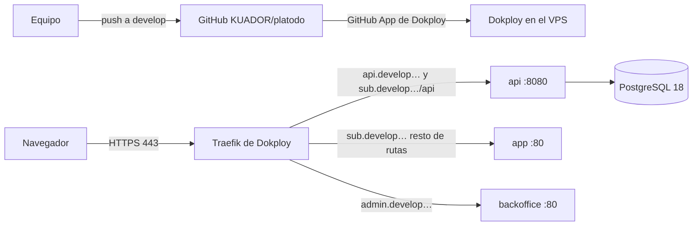

# Manual de despliegue en Dokploy · ambiente de pruebas (`develop`)

Cómo montar en un VPS con Dokploy el ambiente de pruebas de Playtodoo: `api`, `app`, `backoffice` y PostgreSQL,
alimentado por la rama `develop` y publicado bajo `develop.play.kuador.com`.

- **Tarjeta:** PLATODO-95 (épica PLATODO-94). **Fecha:** 2026-11-27.
- **Estado:** redactado a partir del código de `develop` y de la documentación de Dokploy v0.31.4. Todavía **no se
  ejecutó en un VPS**: eso lo hace PLATODO-96, que registra la evidencia. Lo que depende de esa prueba está marcado
  **[POR VALIDAR]**.
- **Fuera de este manual:** producción, `movil`, respaldos, monitoreo y cualquier valor de secreto.

> **Regla de secretos.** Este documento solo trae **nombres**. Los valores se escriben a mano en Dokploy y no se
> copian a comentarios, capturas, commits ni mensajes. Si un valor se filtra, se rota (sección 9).

## 1. Qué se despliega



| Servicio en Dokploy | Tipo | Origen | Puerto interno | Público |
|---|---|---|---|---|
| `api` | Application | `api/` (Java 25 · Spring Boot 4.2) | 8080 | Sí, por Traefik |
| `app` | Application | `app/` (React · Vite, pnpm) | 80 | Sí, por Traefik |
| `backoffice` | Application | `backoffice/` (Angular, npm) | 80 | Sí, por Traefik |
| `postgres` | Database (PostgreSQL) | Imagen `postgres:18-alpine` | 5432 | **No** |

Dos cosas del repositorio condicionan todo el manual:

1. **Las webs no llevan la URL de la api en el build.** La descubren por el host:
   - `app` llama a `/api/v1/…` en **su mismo origen** (el host del complejo).
   - `backoffice` solo funciona servido en `admin.<raíz>`: de ahí deduce `api.<raíz>` para la plataforma y
     `<subdominio>.<raíz>` para el soporte a un complejo (`backoffice/src/app/core/api/api-base-url.ts`).
2. **La api resuelve el tenant por el encabezado `Host`** (`{subdominio}.<raíz>`), y atiende el contexto global en
   `api.<raíz>` (ADR-002, ADR-012). `<raíz>` es `PLAYTODOO_ROOT_DOMAIN`.

En este ambiente el borde es el **Traefik de Dokploy**, que reproduce las rutas de `infra/proxy/routes.caddy`. El
proxy Caddy del repositorio no se despliega aquí.

## 2. Subdominios

Dominio raíz del ambiente: **`develop.play.kuador.com`** (decisión del equipo).

| Host | Ruta | Va a | Contexto |
|---|---|---|---|
| `api.develop.play.kuador.com` | todas | `api` | Global, sin tenant (login de Kuador y de jugadores, plataforma) |
| `admin.develop.play.kuador.com` | todas | `backoffice` | Equipo Kuador |
| `<subdominio>.develop.play.kuador.com` | `/api` y `/api/*` | `api` | Tenant: el complejo sale del host |
| `<subdominio>.develop.play.kuador.com` | el resto | `app` | Web del complejo |
| `develop.play.kuador.com`, `www.…` | — | Sin servicio: `404` | Sitio raíz [POR DEFINIR: sitio raíz] |

- El host del backoffice es **`admin`**, no `backoffice`: con otro nombre el backoffice llama a su propio origen y no
  encuentra la api.
- Un subdominio de complejo tiene de 3 a 63 caracteres (`a-z`, `0-9`, guion) y no puede ser uno reservado (`www`,
  `api`, `admin`, `app`, `backoffice`, `dev`, `staging`, `test`, entre otros; lista completa en ADR-012).
- Ejemplos ficticios usados en este manual: `canchas-el-sol` y `la-esquina`.

### DNS

Los crea quien administra la zona `kuador.com` (condición pendiente del equipo):

| Registro | Tipo | Apunta a |
|---|---|---|
| `*.develop.play.kuador.com` | A (y AAAA si el VPS tiene IPv6) | IP pública del VPS |
| `develop.play.kuador.com` | A (opcional, solo si se quiere el `404` propio en la raíz) | IP pública del VPS |

El comodín cubre `api`, `admin` y todos los complejos. El dominio del panel de Dokploy es aparte:
[POR DEFINIR: host del panel de Dokploy].

### Un complejo, dos dominios en Dokploy

Dokploy no acepta comodines en el campo `Host` de un dominio. Por eso **cada complejo ficticio se declara de forma
explícita**: un dominio en `app` y otro en `api` (sección 5.6). El certificado de cada host lo emite Let's Encrypt
por HTTP, sin token del proveedor DNS.

Consecuencia: un subdominio que no se declaró en Dokploy recibe el `404` de Traefik, no la pantalla «Complejo no
encontrado» de `app`. La variante con comodín real, igual a producción, está en el anexo A.

## 3. Requisitos previos

- VPS con Dokploy instalado y el panel accesible por HTTPS desde internet (GitHub debe poder llamarlo). Puertos 80 y
  443 abiertos. Tamaño del VPS: [POR DEFINIR: proveedor y recursos].
- Registros DNS de la sección 2 propagados (`dig +short canchas-el-sol.develop.play.kuador.com` devuelve la IP).
- Una cuenta con permiso de administración sobre `KUADOR/platodo` en GitHub, para instalar la GitHub App.
- En tu equipo: `curl`, `openssl` y `htpasswd` (paquete `apache2-utils` o `httpd-tools`).

## 4. Inventario de variables y secretos

Solo nombres y propósito. «Dónde» es siempre la pestaña `Environment` del servicio en Dokploy, salvo que se indique.

### api

| Nombre | Propósito | Secreto | Obligatoria |
|---|---|---|---|
| `SPRING_DATASOURCE_URL` | URL JDBC de la base: `jdbc:postgresql://<Internal Host>:5432/<Database Name>` | no | sí |
| `SPRING_DATASOURCE_USERNAME` | Usuario de la base | no | sí |
| `SPRING_DATASOURCE_PASSWORD` | Contraseña de la base | **sí** | sí |
| `PLAYTODOO_IDENTITY_TOKEN_SIGNING_KEY` | Clave HMAC-SHA256 (Base64, 256 bits o más) que firma los tokens. Sin ella la api no arranca. Propia de este ambiente | **sí** | sí |
| `PLAYTODOO_ROOT_DOMAIN` | Dominio raíz para resolver el tenant: `develop.play.kuador.com` | no | sí |
| `PLAYTODOO_TENANT_URL_PATTERN` | URL de la web de un complejo: `https://{subdomain}.develop.play.kuador.com` | no | sí |
| `PLAYTODOO_CORS_BACKOFFICE_ORIGIN` | Único origen admitido por CORS: `https://admin.develop.play.kuador.com` | no | sí |
| `SERVER_TOMCAT_REMOTEIP_INTERNAL_PROXIES` | Red desde la que se aceptan los encabezados `X-Forwarded-*`: la subred de `dokploy-network` (sección 5.4) | no | sí |
| `RAILPACK_JDK_VERSION` | Versión de JDK del build: `25` | no | sí (build) |
| `PLAYTODOO_BOOKINGS_PLAYER_API_ENABLED`, `PLAYTODOO_BOOKINGS_STAFF_API_ENABLED` | Activan los endpoints de reservas del jugador y del personal. Por defecto `false`; `true` solo si la prueba los necesita | no | no |
| `PLAYTODOO_IDENTITY_TOKEN_TIME_TO_LIVE`, `PLAYTODOO_AUDIT_ACCESS_SESSION_TIME_TO_LIVE` | Duración de tokens (`PT1H`) y de sesiones de acceso (`PT30M`) | no | no |
| `TENANCY_PURGE_ENABLED`, `TENANCY_PURGE_CRON`, `PLAYTODOO_RETENTION_ENABLED`, `PLAYTODOO_RETENTION_CRON` | Tareas diarias de purga y retención (activas por defecto, 03:00 y 03:30 UTC) | no | no |
| `SPRING_DATASOURCE_HIKARI_MAXIMUM_POOL_SIZE` | Tamaño del pool (por defecto 10; mínimo 2) | no | no |

### app

| Nombre | Propósito | Secreto | Obligatoria |
|---|---|---|---|
| `NIXPACKS_NODE_VERSION` | Versión de Node del build: `22` | no | sí (build) |
| `VITE_PLATFORM_URL` | Destino del botón «Ir a Playtodoo». Sin definir, usa `https://develop.play.kuador.com/`, que hoy responde `404` | no | no |

Todo lo que empieza con `VITE_` queda dentro del JavaScript público: nunca un secreto ahí.

### backoffice

| Nombre | Propósito | Secreto | Obligatoria |
|---|---|---|---|
| `NIXPACKS_NODE_VERSION` | Versión de Node del build: `22` | no | sí (build) |

No tiene variables propias: su configuración es el host `admin.<raíz>`.

### PostgreSQL (formulario del servicio de base de datos)

| Campo en Dokploy | Propósito | Secreto |
|---|---|---|
| `Database Name` | Nombre de la base de la api | no |
| `Database User` | Usuario dueño de la base (crea esquemas: uno global y uno por complejo) | no |
| `Database Password` | Contraseña de ese usuario. Es el mismo valor de `SPRING_DATASOURCE_PASSWORD` | **sí** |

### GitHub

Ningún secreto. Los workflows de CI no usan secretos y no despliegan. La credencial de la GitHub App la guarda
Dokploy; no se copia al repositorio.

## 5. Pasos en Dokploy

Los nombres de campos y botones van como aparecen en Dokploy v0.31.4.

### 5.1 Proyecto

1. `Projects` → `Create Project`. Nombre: `playtodoo`.
2. Dentro del proyecto, crea un environment llamado `develop` (o usa el que viene por defecto) y trabaja siempre en
   él. Producción, cuando exista, va en otro environment o en otro servidor.

### 5.2 PostgreSQL

1. `Create Service` → `Database` → `PostgreSQL`.
2. Completa `Name` (`postgres`), `Database Name`, `Database User`, `Database Password` y, **en este mismo
   formulario**, `Docker image`: `postgres:18-alpine`. La ruta del volumen se decide al crear el servicio según la
   imagen; no la cambies después.
3. Deja vacío `External Port (Internet)`: la base no se publica.
4. `Deploy`. Anota `Internal Host` de la sección de credenciales internas: lo usa `SPRING_DATASOURCE_URL`.
5. Extensiones (una sola vez, antes del primer arranque de la api). En el servicio, `Open Terminal`, y luego:

   ```bash
   psql -U "$POSTGRES_USER" -d "$POSTGRES_DB"
   ```

   Pega el contenido de `api/docker/postgres/initdb/01-extensions.sql` (crea el esquema `extensions` y `btree_gist`,
   que exige la restricción contra reservas solapadas). Comprueba:

   ```sql
   SELECT extnamespace::regnamespace FROM pg_extension WHERE extname = 'btree_gist';  -- extensions
   ```

### 5.3 Conexión con GitHub

Ver la sección 6. Hazla antes de crear las aplicaciones.

### 5.4 api

1. `Create Service` → `Application`. Nombre: `api`.
2. Pestaña `General`, proveedor `Github`: cuenta de la GitHub App, repositorio `KUADOR/platodo`, `Branch`:
   `develop`, `Build Path`: `/api`, `Watch Paths`: `api/**`. `Trigger Type`: `On Push`.
3. `Build Type`: `Railpack`. Nixpacks no sirve aquí: no ofrece JDK 25. **[POR VALIDAR]** que Railpack compile con
   `RAILPACK_JDK_VERSION=25` y arranque el jar; si no lo logra, la api necesita un `Dockerfile`, que es un cambio de
   código y va en una tarjeta aparte (sección 9).
4. Pestaña `Environment`: carga las variables obligatorias de la sección 4.
   - Clave de firma: genera el valor en tu equipo con `openssl rand -base64 32` y pégalo directo en Dokploy.
   - `SERVER_TOMCAT_REMOTEIP_INTERNAL_PROXIES`: en el VPS, `docker network inspect dokploy-network | grep Subnet`, y
     usa esa subred en formato CIDR.
5. `Deploy`. El primer arranque crea los esquemas `global` y `no_tenant` con Flyway. El log debe terminar con
   `Started` y sin errores de migración (pestaña `Logs`).
6. Pestaña `Domains` → `Add Domain`: `Host` `api.develop.play.kuador.com`, `Path` `/`, `Container Port` `8080`,
   `HTTPS` activado, `Certificate Provider` `Let's Encrypt`.

### 5.5 app y backoffice

Ambas son sitios estáticos: Nixpacks compila y Dokploy sirve el resultado con NGINX en el puerto 80.

| Campo | `app` | `backoffice` |
|---|---|---|
| `Branch` | `develop` | `develop` |
| `Build Path` | `/app` | `/backoffice` |
| `Watch Paths` | `app/**` | `backoffice/**` |
| `Build Type` | `Nixpacks` | `Nixpacks` |
| `Publish Directory` | `./dist` | `./dist/backoffice/browser` |
| `Single Page Application (SPA)` | activado | activado |
| `Environment` | `NIXPACKS_NODE_VERSION=22` | `NIXPACKS_NODE_VERSION=22` |
| Comando que debe ejecutar el build | `pnpm build` | `npm run build` |

- La casilla SPA hace que una ruta interna (por ejemplo `/complejos/…`) devuelva `index.html` al recargar.
- `app` fija `pnpm@12.23.0` en `packageManager`. **[POR VALIDAR]** que Nixpacks instale esa versión.
- Dominio de `backoffice`: `Host` `admin.develop.play.kuador.com`, `Path` `/`, `Container Port` `80`, `HTTPS`
  activado, `Let's Encrypt`.
- `app` no lleva un dominio propio: recibe los de cada complejo (5.6).

### 5.6 Dominios de cada complejo ficticio

Por cada complejo, por ejemplo `canchas-el-sol`, agrega **dos** dominios con el mismo `Host`
`canchas-el-sol.develop.play.kuador.com`, ambos con `HTTPS` activado y `Let's Encrypt`:

| En el servicio | `Path` | `Container Port` | `Strip Path` |
|---|---|---|---|
| `api` | `/api` | `8080` | desactivado |
| `app` | `/` | `80` | — |

Traefik da prioridad a la regla más larga, así que `/api` llega a la api y el resto a `app`. No actives `Strip Path`:
la api espera la ruta completa `/api/v1/…`. Los dominios se aplican sin volver a desplegar.

Si el propietario cambia el subdominio de un complejo, repite este paso con el nuevo y borra los dos dominios
anteriores.

### 5.7 Red interna

No hay que crear redes: todos los servicios quedan en `dokploy-network` y se alcanzan por nombre. Solo la api habla
con PostgreSQL, por `Internal Host`. No publiques puertos de ningún servicio (`Advanced` → `Ports` vacío): la única
entrada es Traefik por 80 y 443.

## 6. Pasos en GitHub

1. **GitHub App de Dokploy.** En Dokploy: `Settings` → `Git` → `Github` → elige la organización `KUADOR` →
   `Create Github App` → `Install`. En GitHub, limita la instalación a **solo el repositorio `platodo`** y confirma
   con `Install & Authorize`. La app pide lectura del contenido y recibe los eventos `push`.
2. **Auto-despliegue.** Con la GitHub App no se crea ningún webhook a mano: la app ya trae el suyo, que llama al
   panel de Dokploy. En cada aplicación, deja `Autodeploy` activado y `Branch` en `develop`. Un push a `develop`
   despliega solo las piezas cuyo `Watch Paths` coincide con los archivos cambiados.
3. **Rama `develop`.** Es la rama protegida de trabajo: todo entra por Pull Request con el check `ci` en verde. Dokploy
   despliega lo que llega a `develop` sin mirar el CI, así que la protección de la rama es la que evita desplegar
   código roto. No hagas push directo a `develop`.
4. **Secretos en GitHub.** Ninguno (`Settings` → `Secrets and variables` → `Actions` queda sin secretos de
   despliegue).

Alternativa sin GitHub App (repositorio conectado como `Git` genérico): copia el `Webhook URL` de la pestaña
`Deployments` de cada aplicación y créalo en GitHub (`Settings` → `Webhooks`, evento `push`, tipo de contenido
`application/json` **[POR VALIDAR]**). Esa URL incluye un token: trátala como secreto. No la uses si la GitHub App
funciona.

## 7. Cómo se conectan app y backoffice con la api

| Quién | Llama a | Cómo lo sabe | Qué lo permite |
|---|---|---|---|
| `app` en `canchas-el-sol.develop.play.kuador.com` | `https://canchas-el-sol.develop.play.kuador.com/api/v1/…` | Mismo origen | El dominio con `Path` `/api` del servicio `api` (5.6). Sin CORS |
| `backoffice` en `admin.develop.play.kuador.com` | `https://api.develop.play.kuador.com/api/v1/…` (plataforma) | Cambia `admin` por `api` en su host | `PLAYTODOO_CORS_BACKOFFICE_ORIGIN` |
| `backoffice`, con sesión de soporte | `https://<subdominio>.develop.play.kuador.com/api/v1/…` | Host del complejo que devuelve la api | `PLAYTODOO_CORS_BACKOFFICE_ORIGIN` y el encabezado `X-Support-Session` (ADR-020) |

Resolución del tenant: Traefik entrega a la api el `Host` original; la api quita `PLAYTODOO_ROOT_DOMAIN`, toma la
primera etiqueta como subdominio y abre el esquema `t_<uuid>` de ese complejo. Un endpoint de tenant pedido en
`api.…` responde `404`, y uno global pedido en el host de un complejo también.

## 8. Datos: solo ficticios

**En este ambiente solo se cargan datos ficticios.** No se copian bases de producción ni se registran complejos,
personas, correos o teléfonos reales (decisión del equipo en PLATODO-94). Usa nombres inventados y correos del
dominio reservado `example.test`.

La base arranca vacía. Carga mínima para probar:

1. **Primera persona de Kuador** (no hay pantalla ni endpoint que la cree). En tu equipo, genera el hash; el comando
   pide la contraseña sin mostrarla:

   ```bash
   htpasswd -nBC 10 "" | tr -d ':\n'
   ```

   En la terminal de PostgreSQL (5.2), con el resultado precedido por `{bcrypt}`:

   ```sql
   INSERT INTO global.platform_user (id, email, password_hash, role, status, created_at, display_name)
   VALUES (gen_random_uuid(), 'super@example.test', '{bcrypt}<hash>', 'SUPER_ADMIN', 'ACTIVE', now(), 'Super de pruebas');
   ```

2. **Monedas y periodicidades de plan**, mientras sigan vacías. Valores de prueba, no una decisión de negocio
   ([POR DEFINIR: monedas y periodicidades reales]):

   ```sql
   UPDATE global.platform_parameter SET value = '["USD"]' WHERE key = 'plan.currencies' AND value = '[]';
   UPDATE global.platform_parameter SET value = '["MONTHLY"]' WHERE key = 'plan.periodicities' AND value = '[]';
   ```

3. **Complejos.** Entra a `https://admin.develop.play.kuador.com`, crea y publica un plan, y da de alta dos complejos
   ficticios (`canchas-el-sol` y `la-esquina`). Luego agrega sus dominios (5.6).
4. **Contraseña del personal** de cada complejo (todavía no hay flujo que la fije). Solo en este ambiente:

   ```sql
   SELECT schema_name, display_name FROM global.tenant;
   UPDATE <schema_name>.staff_user SET password_hash = '{bcrypt}<hash>' WHERE email = '<correo del propietario>';
   ```

Para empezar de cero: borra el servicio de PostgreSQL con su volumen, créalo otra vez (5.2) y vuelve a desplegar la
api.

## 9. Operación

- **Cada despliegue:** se fusiona un Pull Request en `develop` → Dokploy construye y reemplaza las piezas afectadas.
  Las migraciones de Flyway corren solas al arrancar la api. El progreso se ve en `Deployments`; los logs de
  ejecución, en `Logs`.
- **Variable nueva:** las notas de `docs/deployment/changes/` dicen qué variable agrega cada tarjeta. Cárgala en
  Dokploy **antes** de fusionar el PR que la necesita y actualiza la sección 4.
- **Vuelta atrás:** revierte el commit en `develop` con un Pull Request (`git revert`); Dokploy despliega la versión
  anterior. Las migraciones no se deshacen: la versión anterior ignora las tablas nuevas.
- **Rotar un secreto:** cambia el valor en `Environment` y pulsa `Deploy`. Cambiar la clave de firma cierra todas las
  sesiones. Cambiar la contraseña de la base exige cambiarla también en PostgreSQL (`ALTER ROLE … PASSWORD`).
- **Si falta código de build** (por ejemplo, un `Dockerfile` para la api): no se resuelve en el VPS; se abre una
  tarjeta aparte.

## 10. Lista de verificación post-despliegue

Sustituye los subdominios por los de tus complejos ficticios.

| # | Pieza | Comprobación | Esperado |
|---|---|---|---|
| 1 | PostgreSQL | En su terminal: `SELECT extnamespace::regnamespace FROM pg_extension WHERE extname = 'btree_gist';` | `extensions` |
| 2 | PostgreSQL | `SELECT count(*) FROM global.flyway_schema_history WHERE success;` | 11 o más, ninguna fila con `success = false` |
| 3 | PostgreSQL | Desde tu equipo: `nc -zv <IP del VPS> 5432` | Conexión rechazada o sin respuesta |
| 4 | api (global) | `curl -i https://api.develop.play.kuador.com/api/v1/subdomains/www/availability` | `200` con `"reason": "RESERVED"` |
| 5 | api + base | `curl -i -X POST https://api.develop.play.kuador.com/api/v1/auth/players/login -H 'Content-Type: application/json' -d '{"email":"nadie@example.test","password":"x"}'` | `401` `INVALID_CREDENTIALS` |
| 6 | api (tenant) | `curl -i https://canchas-el-sol.develop.play.kuador.com/api/v1/tenant` | `200` con los datos del complejo |
| 7 | api (tenant) | `curl -i https://api.develop.play.kuador.com/api/v1/tenant` | `404` `RESOURCE_NOT_FOUND` |
| 8 | CORS | `curl -i -X OPTIONS https://canchas-el-sol.develop.play.kuador.com/api/v1/tenant -H 'Origin: https://admin.develop.play.kuador.com' -H 'Access-Control-Request-Method: GET'` | `200` con `Access-Control-Allow-Origin`; con otro `Origin`, `403` |
| 9 | app | Abrir `https://canchas-el-sol.develop.play.kuador.com` y recargar en una ruta interna | Carga la web del complejo, sin «No pudimos comprobar el complejo» |
| 10 | backoffice | Abrir `https://admin.develop.play.kuador.com`, iniciar sesión y listar complejos | Lista sin errores de red ni de CORS en la consola |
| 11 | Aislamiento | Iniciar sesión con el personal de `canchas-el-sol` en `https://la-esquina.develop.play.kuador.com/api/v1/auth/staff/login` | `401` `INVALID_CREDENTIALS` |
| 12 | TLS | `curl -sI https://admin.develop.play.kuador.com \| head -1` y lo mismo con `http://` | `200` por HTTPS; redirección a HTTPS por HTTP |
| 13 | Auto-despliegue | Fusionar en `develop` un PR que toque solo `app/` | Aparece un despliegue nuevo en `app` y ninguno en `api` ni `backoffice` |
| 14 | Secretos | Revisar el diff de cualquier cambio a este manual | Solo nombres |

## 11. Diagnóstico de fallos comunes

| Síntoma | Causa probable | Qué hacer |
|---|---|---|
| El build de la api falla por la versión de Java | Falta `RAILPACK_JDK_VERSION=25`, o Railpack no ofrece JDK 25 | Cargar la variable. Si persiste, tarjeta aparte para un `Dockerfile` de la api |
| La api se reinicia: falta `signing-key` | No está `PLAYTODOO_IDENTITY_TOKEN_SIGNING_KEY` | Cargarla (sección 5.4) y `Deploy` |
| La api no arranca: `Connection refused` o `password authentication failed` | `SPRING_DATASOURCE_*` no coincide con el servicio de base | Revisar `Internal Host`, base, usuario y contraseña |
| La api no arranca: error de Flyway con `gist` o `btree_gist` | No se ejecutó `01-extensions.sql` | Paso 5 de 5.2 y volver a desplegar |
| `404` de Traefik (`404 page not found`) en el host de un complejo | Faltan sus dominios en Dokploy o el DNS no propagó | Sección 5.6; `dig +short <host>` |
| `404` `TENANT_NOT_FOUND` en un complejo que existe | `PLAYTODOO_ROOT_DOMAIN` distinto del dominio real | Debe ser exactamente `develop.play.kuador.com` |
| `app` muestra «No pudimos comprobar el complejo» | Falta el dominio con `Path` `/api` en `api`, o la api está caída | Sección 5.6; `Logs` de la api |
| `/api/v1/…` devuelve HTML en el host de un complejo | El dominio `/api` está en `app` o no existe | Corregirlo en el servicio `api` |
| El backoffice carga pero el login falla con error de CORS | `PLAYTODOO_CORS_BACKOFFICE_ORIGIN` no es exactamente `https://admin.develop.play.kuador.com` | Corregir (sin barra final) y `Deploy` |
| El backoffice llama a `admin.…/api/v1` y recibe HTML | Se publicó en un host que no empieza por `admin.` | Usar `admin.develop.play.kuador.com` |
| Recargar una ruta interna da `404` de NGINX | Casilla `Single Page Application (SPA)` desactivada | Activarla y `Deploy` |
| La web sale en blanco o el build «termina» sin archivos | `Publish Directory` equivocado | `./dist` en `app`, `./dist/backoffice/browser` en `backoffice` |
| Aviso de certificado no válido | Let's Encrypt no pudo validar: DNS sin propagar o puerto 80 cerrado | Corregir y volver a guardar el dominio. Let's Encrypt limita los intentos fallidos por hora |
| Un push a `develop` no despliega | `Autodeploy` apagado, `Branch` distinta, `Watch Paths` sin coincidencia o panel inaccesible desde GitHub | Revisar la aplicación y, en GitHub, las entregas recientes del webhook de la GitHub App |
| `403` del backoffice tras un despliegue que cambia roles | Token emitido antes del cambio | Cerrar sesión y volver a entrar |

## Anexo A · Variante con comodín (no validada)

Evita declarar los dominios de cada complejo y deja que la api y `app` respondan «Complejo no encontrado», como en
producción. A cambio exige un certificado comodín, que Let's Encrypt solo emite por el desafío DNS-01, y por tanto un
token del proveedor DNS de `kuador.com`. **[POR VALIDAR]** completo; úsala solo si la sección 5.6 se queda corta.

1. `Settings` → `Web Server` → `Traefik` → `Modify Environment`: las variables del proveedor DNS (**secreto**;
   nombres según el proveedor: [POR DEFINIR: proveedor DNS de `kuador.com`]). El token debe limitarse a editar
   registros TXT de la zona.
2. En `traefik.yml`, un resolver nuevo junto al que ya existe:

   ```yaml
   certificatesResolvers:
     letsencrypt-dns:
       acme:
         email: <correo de operaciones>
         storage: /etc/dokploy/traefik/dynamic/acme-dns.json
         dnsChallenge:
           provider: <proveedor>
   ```

3. En `Traefik File System`, un archivo dinámico nuevo. Las prioridades bajas dejan ganar a los dominios de
   `api.…` y `admin.…` creados por Dokploy:

   ```yaml
   http:
     routers:
       platodo-tenant-api:
         rule: "HostRegexp(`^[a-z0-9-]+\\.develop\\.play\\.kuador\\.com$`) && PathPrefix(`/api`)"
         entryPoints: [websecure]
         service: platodo-tenant-api
         priority: 2
         tls:
           certResolver: letsencrypt-dns
           domains:
             - main: "develop.play.kuador.com"
               sans: ["*.develop.play.kuador.com"]
       platodo-tenant-app:
         rule: "HostRegexp(`^[a-z0-9-]+\\.develop\\.play\\.kuador\\.com$`)"
         entryPoints: [websecure]
         service: platodo-tenant-app
         priority: 1
         tls:
           certResolver: letsencrypt-dns
     services:
       platodo-tenant-api:
         loadBalancer:
           passHostHeader: true
           servers:
             - url: "http://<nombre interno del servicio api>:8080"
       platodo-tenant-app:
         loadBalancer:
           servers:
             - url: "http://<nombre interno del servicio app>:80"
   ```

4. Borra los dominios por complejo de la sección 5.6 y recarga Traefik.

## Referencias

- Rutas por host: `infra/proxy/routes.caddy`, `infra/proxy/README.md`. Reglas de subdominio: ADR-012.
- Variables por tarjeta: `docs/deployment/changes/`. Propiedades de la api: `api/src/main/resources/application.properties`.
- Entorno local equivalente: `infra/local/README.md`.
- Dokploy: <https://docs.dokploy.com/docs/core/applications/build-type>, <https://docs.dokploy.com/docs/core/domains>,
  <https://docs.dokploy.com/docs/core/github>, <https://docs.dokploy.com/docs/core/auto-deploy>,
  <https://docs.dokploy.com/docs/core/watch-paths>, <https://docs.dokploy.com/docs/core/databases>,
  <https://docs.dokploy.com/docs/core/variables>.
